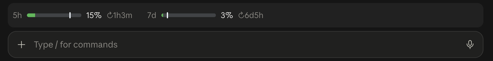

# quota-band

A Claude Code plugin that shows your subscription quota (the 5-hour and weekly
limits) in a slim row directly above the prompt, with a pace marker so you can
see at a glance whether you're spending faster than the window refills.

## What it looks like



In a terminal, the same row is drawn with block characters:

```
5h ████░░░░░│░░░░░░░░░░░░░░░░░░░░  13%  ↻3h28m    7d █░│░░░░░░░░░░░░░░░░░░░░░░░░░░░   2%  ↻6d7h
```

- **Bar**: how much of the limit you've used. On desktop, hover it for details.
- **Pace marker**: the white tick (`│` in a terminal) shows how far through the
  window you are in time. Fill past the marker means you're ahead of pace.
- **`↻`**: time until the window resets.
- **Color**: green on pace, yellow when more than 5 points ahead, red when more
  than 15 points ahead or at 90% used.

The plugin needs a Claude Pro or Max subscription. With an API key, Bedrock or
Vertex there's no quota to show.

## Install

At the prompt of a terminal session:

```
/plugin install quota-band --marketplace arsinio/claude-code-quota-band
```

Or from a shell:

```bash
claude plugin install quota-band --marketplace arsinio/claude-code-quota-band
```

In the desktop app, click **+** next to the prompt box, then **Plugins** →
**Add marketplace** with `arsinio/claude-code-quota-band`, then **Add plugin**.

Installed at user scope, it appears in every new session, terminal and desktop.

## Develop

```bash
claude plugin validate .
```

```bash
claude plugin test .
```

## License

MIT
